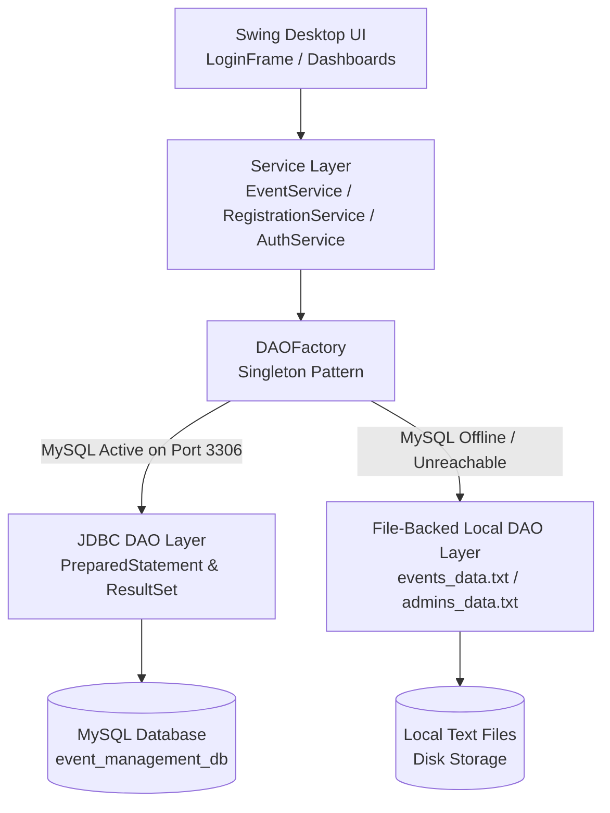

# Eventora — Campus Event Management System

[](https://www.oracle.com/java/)
[](https://docs.oracle.com/javase/tutorial/uiswing/)
[](https://dev.mysql.com/doc/connector-j/en/)
[-green)](https://ktu.edu.in)

**Eventora** is a desktop-based event management, session scheduling, and student registration application developed strictly in accordance with the **APJ Abdul Kalam Technological University (KTU) S3 2024 Scheme — Object-Oriented Programming with Java** syllabus.

The system features dual-engine architecture: it connects directly to **MySQL via JDBC** when available, and automatically falls back to a **File-Backed Local Storage Engine** if MySQL is offline. This ensures the application runs on any evaluation computer without requiring mandatory database setup.

---

## 📑 Table of Contents
1. [Key Features](#-key-features)
2. [KTU S3 Syllabus & OOP Concept Mapping](#-ktu-s3-syllabus--oop-concept-mapping)
3. [Architecture & Storage Engine](#-architecture--storage-engine)
4. [Project Structure](#-project-structure)
5. [Prerequisites](#-prerequisites)
6. [How to Run the Application](#-how-to-run-the-application)
7. [Default Login Credentials](#-default-login-credentials)
8. [Database Setup (Optional)](#-database-setup-optional)
9. [Automated Verification & Testing](#-automated-verification--testing)

---

## 🌟 Key Features

### 👨‍💼 1. Administrator Portal
- **Event Lifecycle Management:** Create, view, update, and delete campus events with details including venue, date, organizer, and registration fee.
- **Session Scheduling:** Attach multiple chronological sessions to events with automated start/end time validation.
- **Participant Administration:** View registered participants and search attendees across events.
- **Offline Payment Verification Desk:** Review pending student payments, verify offline cash collections at venue desks, and accept or reject transactions with automated remarks.

### 🎓 2. Student Portal
- **Self-Service Sign-Up & Authentication:** Students can register personal accounts and log in securely.
- **Browse & Filter Events:** Search events by keyword or date with real-time session counts.
- **One-Click Event Enrollment:** Enroll in free events or submit registration with offline venue payment notes.
- **Registration Tracking:** Real-time enrollment and payment status updates (`PENDING_APPROVAL`, `CONFIRMED`, `REJECTED`).
- **Digital Registration Receipt:** Generate and display formatted registration and payment receipts.
- **Schedule Viewer:** View scheduled session timelines and venue rooms for registered events.
- **Self-Service Cancellation:** Cancel event registrations with automated confirmation prompts.

---

## 🎓 KTU S3 Syllabus & OOP Concept Mapping

This codebase is intentionally designed and reviewed to follow the **KTU S3 2024 Scheme** without out-of-syllabus features (no Lambdas, no Stream API, no Modern Date APIs, and no external frameworks).

| KTU Syllabus Topic | Implementation in Eventora | Primary Source Files |
|---|---|---|
| **Classes & Objects** | Encapsulated entity models with private fields and public accessors/mutators. | [`Event.java`](src/main/java/com/eventmgmt/model/Event.java), [`Session.java`](src/main/java/com/eventmgmt/model/Session.java) |
| **Inheritance** | Superclass `User` extended by specialized subclasses: `Admin`, `Participant`, and `Organizer`. | [`User.java`](src/main/java/com/eventmgmt/model/User.java), [`Admin.java`](src/main/java/com/eventmgmt/model/Admin.java), [`Participant.java`](src/main/java/com/eventmgmt/model/Participant.java) |
| **Polymorphism & Dynamic Dispatch** | Method overriding (`getSummary()`, `displayDetails()`, `toString()`) resolved at runtime. | Model hierarchy & [`Displayable.java`](src/main/java/com/eventmgmt/model/interfaces/Displayable.java) |
| **Abstraction & Interfaces** | Contract interfaces decoupling business logic from UI and data layers. | [`Displayable.java`](src/main/java/com/eventmgmt/model/interfaces/Displayable.java), [`Schedulable.java`](src/main/java/com/eventmgmt/model/interfaces/Schedulable.java), DAO interfaces |
| **Constructors & Chaining** | Constructor overloading with `this(...)` and `super(...)` calls for clean state initialization. | [`Registration.java`](src/main/java/com/eventmgmt/model/Registration.java), [`Event.java`](src/main/java/com/eventmgmt/model/Event.java) |
| **Exception Handling** | Robust `try-catch-finally` blocks, checked/unchecked exceptions, and custom domain exceptions. | [`EventManagementException.java`](src/main/java/com/eventmgmt/exception/EventManagementException.java), [`DuplicateRegistrationException.java`](src/main/java/com/eventmgmt/exception/DuplicateRegistrationException.java) |
| **Delegation Event Model** | Swing event-driven architecture using `ActionListener` and `ListSelectionListener` via inner classes. | UI panels in [`com.eventmgmt.ui`](src/main/java/com/eventmgmt/ui/) |
| **Swing Layout Managers** | Standard Swing containers using `BorderLayout`, `FlowLayout`, and `GridBagLayout`. | [`LoginFrame.java`](src/main/java/com/eventmgmt/ui/LoginFrame.java), [`AdminDashboardFrame.java`](src/main/java/com/eventmgmt/ui/AdminDashboardFrame.java) |
| **Design Patterns (Syllabus)** | **Singleton Pattern** managing active DAO lifecycle; **DAO Pattern** decoupling storage from business services. | [`DAOFactory.java`](src/main/java/com/eventmgmt/dao/DAOFactory.java) |
| **JDBC & Database Connectivity** | `DriverManager`, `Connection`, `PreparedStatement`, and `ResultSet` for SQL CRUD operations. | Package [`com.eventmgmt.dao.jdbc`](src/main/java/com/eventmgmt/dao/jdbc/) |
| **Syllabus Data Structures** | Traditional arrays, `Vector<T>`, and indexed `for` loops without Stream API or lambdas. | Package [`com.eventmgmt.dao.inmemory`](src/main/java/com/eventmgmt/dao/inmemory/) |

---

## 🏗️ Architecture & Storage Engine

Eventora uses a **Dual Storage Architecture** managed by [`DAOFactory`](src/main/java/com/eventmgmt/dao/DAOFactory.java):



- **Database Mode (MySQL):** Connects through JDBC driver (`mysql-connector-j-8.3.0.jar`) with full ACID constraints and foreign key cascading.
- **Failover Mode (Local File Storage):** If MySQL is not detected, the system automatically runs on local file storage without throwing connection errors or crashing.

---

## 📂 Project Structure

```text
EventManagementSystem_Project/
├── database/                        # Database setup scripts
│   ├── schema.sql                   # Table schemas, constraints, foreign keys
│   └── sample_data.sql              # Pre-populated test records
├── lib/                             # Standalone JDBC Connector library
│   └── mysql-connector-j-8.3.0.jar  # For zero-config offline execution
├── src/main/java/com/eventmgmt/
│   ├── Main.java                    # Application entry point
│   ├── SystemIntegrationTest.java   # Automated verification suite
│   ├── dao/                         # DAO Interfaces & Singleton Factory
│   │   ├── DAOFactory.java
│   │   ├── inmemory/                # Local file-storage implementation
│   │   └── jdbc/                    # MySQL JDBC implementation
│   ├── exception/                   # Domain-specific custom exceptions
│   ├── model/                       # Core OOP entities & interfaces
│   ├── service/                     # Business logic services
│   ├── ui/                          # Swing UI frames, panels, and listeners
│   └── util/                        # DBConnection, DateTimeUtil, ConsoleUtil
├── src/main/resources/              # db.properties configuration
├── .vscode/                         # Pre-configured launch & classpath settings
├── pom.xml                          # Maven build definition
├── db.properties.example            # Sample configuration template
└── README.md                        # Documentation
```

---

## 💻 Prerequisites

- **Java Development Kit (JDK):** Version 17 or higher (LTS recommended).
- **Editor / IDE:** VS Code (with *Extension Pack for Java*), Eclipse, IntelliJ IDEA, or NetBeans.
- **Database (Optional):** MySQL Server 8.x or XAMPP (if testing JDBC mode).

---

## 🚀 How to Run the Application

### Option 1: In VS Code (Recommended — 1-Click Run)
1. Open VS Code.
2. Select **File → Open Folder...** and choose `EventManagementSystem_Project`.
3. Press **`F5`** or click **Run** at the top right of [`Main.java`](src/main/java/com/eventmgmt/Main.java).
4. The pre-configured `.vscode/launch.json` and `.vscode/settings.json` automatically attach the source files and JDBC connector.

### Option 2: Using the Command Line (Manual javac)
Open your terminal inside `EventManagementSystem_Project`:

```bash
# 1. Compile all Java source files
javac -cp "lib/mysql-connector-j-8.3.0.jar;src/main/java" -d target/classes src/main/java/com/eventmgmt/Main.java src/main/java/com/eventmgmt/*/*.java src/main/java/com/eventmgmt/*/*/*.java

# 2. Run the Desktop Application
java -cp "target/classes;lib/mysql-connector-j-8.3.0.jar" com.eventmgmt.Main
```
*(On Linux/macOS, replace the semicolon `;` in `-cp` with a colon `:`).*

### Option 3: Using Apache Maven
```bash
mvn clean compile
mvn exec:java -Dexec.mainClass="com.eventmgmt.Main"
```

---

## 🔑 Default Login Credentials

### Administrator Login
- **Role:** System Administrator
- **Username:** `admin`
- **Password:** `admin123`

### Student Accounts
- You can immediately register a new student using the **"Student Sign-Up"** tab on the login screen.
- Or log in with pre-seeded credentials from `sample_data.sql`:
  - **Student 1:** Email: `rahul.menon@college.edu` | Password: `password123`
  - **Student 2:** Email: `anjali.nair@college.edu` | Password: `password123`
  - **Student 3:** Email: `sneha.patel@college.edu` | Password: `password123`

---

## 🗄️ Database Setup (Optional)

If you wish to run in full MySQL persistent storage mode:

1. Open MySQL Workbench, MySQL CLI, or phpMyAdmin (XAMPP).
2. Execute the database scripts in order:
   ```sql
   source database/schema.sql;
   source database/sample_data.sql;
   ```
3. Edit `db.properties` (or copy `db.properties.example` to `db.properties`):
   ```properties
   db.enabled=true
   db.url=jdbc:mysql://localhost:3306/event_management_db?useSSL=false&allowPublicKeyRetrieval=true&serverTimezone=UTC
   db.username=root
   db.password=your_mysql_password
   ```

---

## 🧪 Automated Verification & Testing

The project includes an end-to-end integration test suite verifying core OOP features, database transactions, exception triggers, and business validations:

### Run via VS Code:
In the **Run and Debug** menu (`Ctrl+Shift+D`), select **Launch SystemIntegrationTest** and click Play.

### Run via Command Line:
```bash
java -cp "target/classes;lib/mysql-connector-j-8.3.0.jar" com.eventmgmt.SystemIntegrationTest
```

### Test Suite Output:
```text
--- STARTING SYSTEM INTEGRATION TEST ---
[DBConnection] Database schema and tables successfully verified.
[DAOFactory] Connected to MySQL Database. Persistent storage ACTIVE.
Storage Engine: MySQL Database (JDBC Connected - Port 3306)
[PASS] Feature 1: Event created and retrieved: Tech Symposium 2026
[PASS] Feature 2a: Participant added: Rahul Menon
[PASS] Feature 2b: Registered participant with ID: REG-46333
[PASS] Feature 2c: Duplicate registration correctly caught
[PASS] Feature 3a: Session created and linked: Opening Keynote
[PASS] Feature 3b: Invalid session time correctly caught
[PASS] Cleaned up temporary test records successfully.

*** ALL SYSTEM INTEGRATION TESTS PASSED SUCCESSFULLY! ***
```

---

## 👥 Contributors & Academic Context
- **Course:** Object-Oriented Programming with Java
- **Curriculum:** APJ Abdul Kalam Technological University (KTU) — S3 2024 Scheme
- **Project:** Eventora Campus Event Management System
